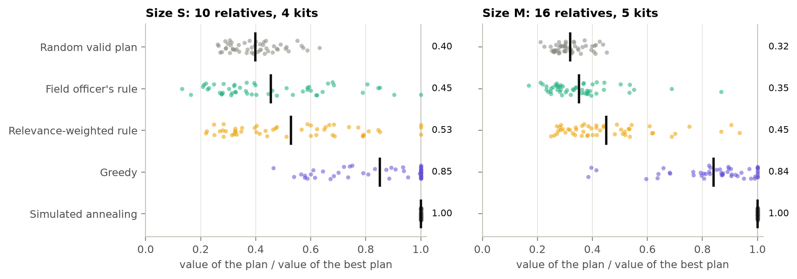
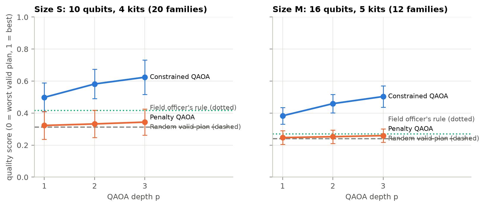
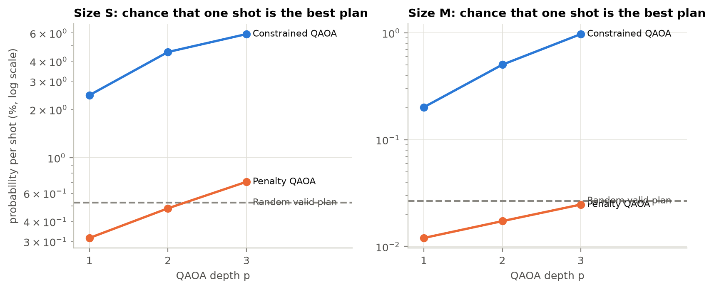
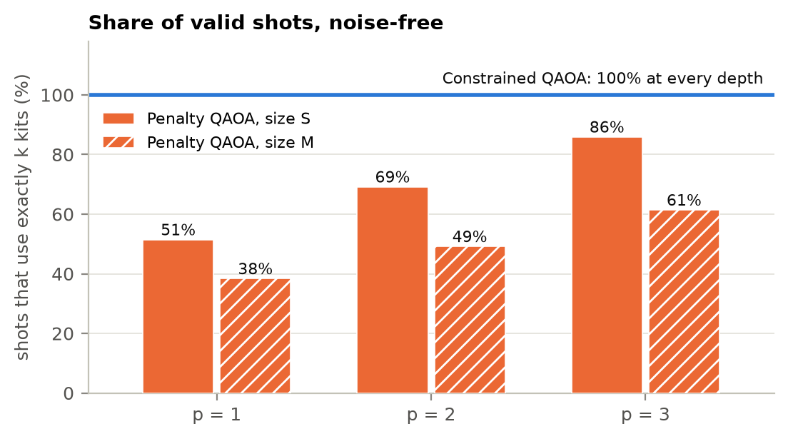
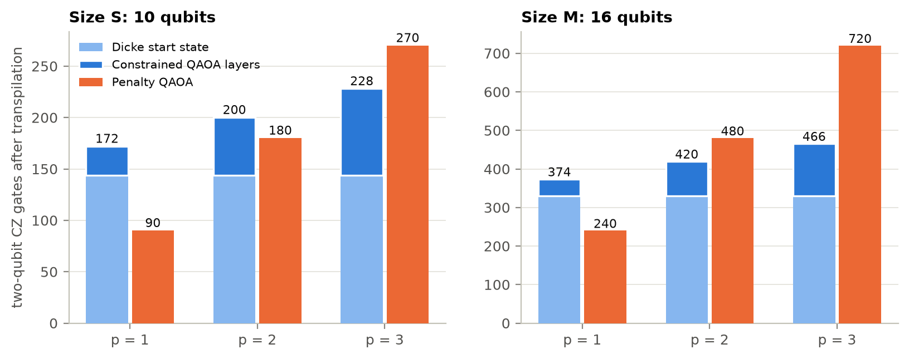
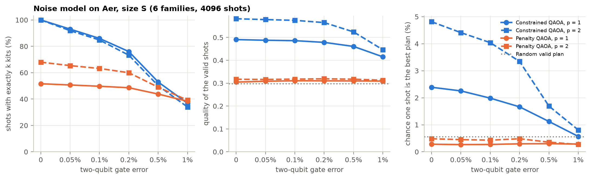
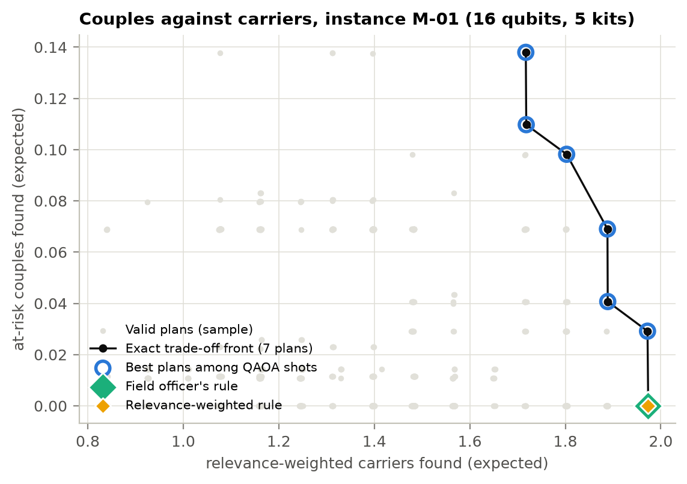
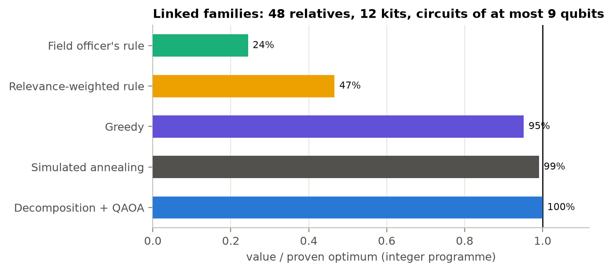
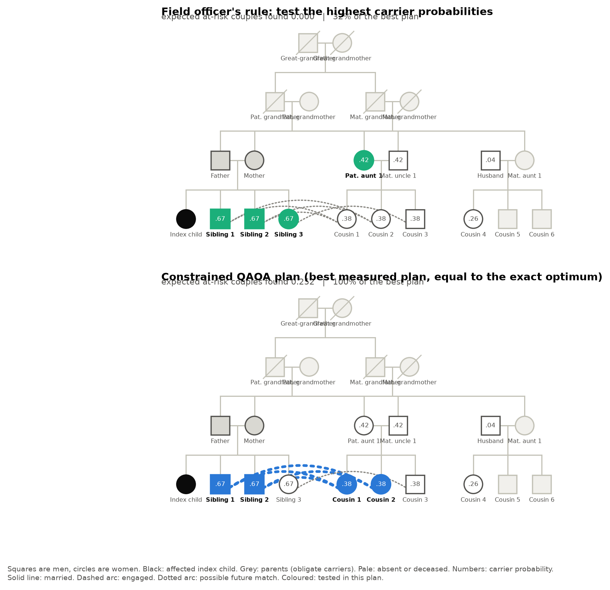
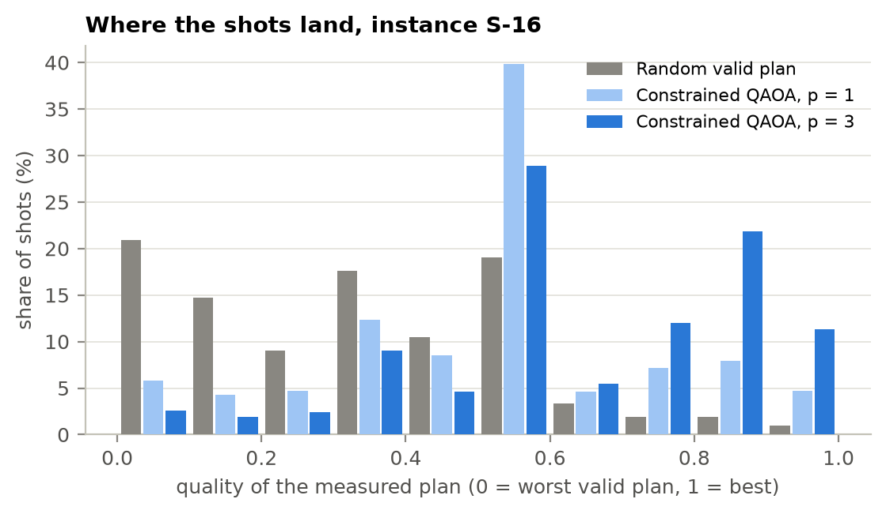

# Benchmark report

Every number below is read from `results/*.json`. This file is generated by `python -m kinship.report_md`; do not edit it by hand.

## Environment

| Item | Value |
|---|---|
| Generated (UTC) | 2026-11-12T14:53:18+00:00 |
| Python | 3.11.0 |
| Qiskit | 2.6.2 |
| Qiskit Aer | 0.18.2 |
| NumPy / SciPy | 2.4.6 / 1.17.1 |
| Hardware | simulator only (Qiskit Aer); no real quantum processor was used |
| Optimiser | COBYLA, at most 150 iterations per start |
| Shots per read-out | 4,096 |
| Instances | 20 of size S (10 relatives, 4 kits), 12 of size M (16 relatives, 5 kits) |
| Total run time | 7.8 minutes on 8 processes |

Definitions. *Quality*: expected value of a measured valid plan, scaled so that the worst valid plan is 0 and the best is 1; shots that break the kit limit are discarded first. *Best plan per shot*: probability that a single shot is an optimal plan, counted over all shots. *Valid shots*: share of shots that use exactly k kits. *Shots for 95%*: shots needed to see an optimal plan with 95% probability (median over instances).

## 1. Pedigree engine against textbook values

| Relative of the affected child | Textbook | Exact formula | Engine |
|---|---|---|---:|
| Parent of the affected child | 1 |  | 1.0000 |
| Unaffected sibling | 2/3 |  | 0.6667 |
| Grandparent | about 1/2 | (1 + q) / 2 | 0.5128 |
| Aunt or uncle | about 1/2 | 2 / (4 - q) | 0.5032 |
| First cousin | about 1/4 |  | 0.2657 |
| Married-in spouse | about the population rate, 0.05 |  | 0.0440 |
| Member of a family with no affected child | about the population rate, 0.05 |  | 0.0488 |
| Both grandparents carriers (joint) | not a product | q | 0.0257 |

Calibration over 120 synthetic families: carrier share among testable relatives 35.5% (31% of tested relatives in Ahmed et al. 2002); both partners carriers among married couples other than the index parents 2.3%, and 26.2% when the index parents are counted (8% of all married couples in the much larger families of that study).

Independent check (`python -m kinship.validate_genetics`): a Monte Carlo gene-dropping simulation with rejection sampling, which shares no code with the engine's inference, was compared with the exact values on 3 families.

| Family | People | Accepted samples | Simulated families | Probabilities compared | Largest deviation (standard errors) |
|---|---:|---:|---:|---:|---:|
| S-16 | 22 | 40,032 | 64,500,000 | 26 | 1.74 |
| S-01 | 15 | 30,323 | 70,500,000 | 16 | 1.58 |
| M-01 | 35 | 30,852 | 25,500,000 | 43 | 2.89 |

Over all 85 carrier and couple probabilities the largest deviation is 2.89 standard errors; 4.7% lie beyond two standard errors (about 5% expected by chance).

## 2. Is the problem trivial? Classical rules against the exact optimum

50 seeded families per size.

| Size | Rule | Value / optimum, mean | Worst family | Misses the best plan |
|---|---|---:|---:|---:|
| S | Random valid plan | 39.9% | 26.2% |  |
| S | Field officer's rule | 45.5% | 13.2% | 98% |
| S | Relevance-weighted rule | 52.8% | 22.0% | 94% |
| S | Greedy | 85.2% | 46.4% | 56% |
| S | Simulated annealing | 100.0% | 100.0% | 0% |
| M | Random valid plan | 31.9% | 21.1% |  |
| M | Field officer's rule | 35.1% | 16.8% | 100% |
| M | Relevance-weighted rule | 45.1% | 24.9% | 100% |
| M | Greedy | 84.1% | 38.5% | 82% |
| M | Simulated annealing | 100.0% | 100.0% | 2% |

Size S: 4.4 couple links on average; the couple term carries 62% of the best plan's value; the largest connected component of the couple graph has 3.7 people on average (maximum 8).
Size M: 9.4 couple links on average; the couple term carries 69% of the best plan's value; the largest connected component of the couple graph has 5.2 people on average (maximum 9).

Tie-breaking, size S: the field officer's rule has a tie in carrier probability at the cut-off in 19 of 50 families. Breaking every tie in its favour gives 48.1% of the optimum on average (every tie against it: 43.1%), and it still misses the best plan in 98% of the families.
Tie-breaking, size M: the field officer's rule has a tie in carrier probability at the cut-off in 15 of 50 families. Breaking every tie in its favour gives 38.0% of the optimum on average (every tie against it: 34.6%), and it still misses the best plan in 100% of the families.

Greedy and ties, size S: greedy also breaks ties by index. Breaking them the other way changes its result in 17 of 50 families, by up to 46% of the optimum (mean value / optimum 89.3% instead of 85.2%).
Greedy and ties, size M: greedy also breaks ties by index. Breaking them the other way changes its result in 13 of 50 families, by up to 54% of the optimum (mean value / optimum 79.2% instead of 84.1%).



## 3. QAOA against the references

| Size | Method | p | Quality | Value / optimum | Best plan per shot | Gain over random | Valid shots | Shots for 95% | Returns the best plan |
|---|---|---:|---:|---:|---:|---:|---:|---:|---:|
| S | Random valid plan |  | 0.312 +/- 0.089 | 42.8% | 0.52% |  | 100% | 628 |  |
| S | Field officer's rule |  | 0.416 +/- 0.280 | 50.9% |  |  | 100% |  | 5% |
| S | Relevance-weighted rule |  | 0.525 +/- 0.290 | 60.4% |  |  | 100% |  | 10% |
| S | Greedy |  | 0.864 +/- 0.204 | 89.1% |  |  | 100% |  | 60% |
| S | Simulated annealing |  | 1.000 +/- 0.000 | 100.0% |  |  | 100% |  | 100% |
| S | Constrained QAOA | 1 | 0.498 +/- 0.090 | 58.2% | 2.5% | 4.8x | 100% | 119 | 100% |
| S | Constrained QAOA | 2 | 0.582 +/- 0.092 | 65.2% | 4.6% | 9.1x | 100% | 64 | 100% |
| S | Constrained QAOA | 3 | 0.624 +/- 0.107 | 68.7% | 5.9% | 12.1x | 100% | 70 | 100% |
| S | Penalty QAOA | 1 | 0.323 +/- 0.087 | 43.7% | 0.32% | 0.6x | 51% | 1,044 | 100% |
| S | Penalty QAOA | 2 | 0.332 +/- 0.085 | 44.5% | 0.48% | 0.9x | 69% | 668 | 100% |
| S | Penalty QAOA | 3 | 0.344 +/- 0.082 | 45.5% | 0.71% | 1.4x | 86% | 437 | 100% |
| M | Random valid plan |  | 0.240 +/- 0.042 | 32.1% | 0.027% |  | 100% | 13,084 |  |
| M | Field officer's rule |  | 0.270 +/- 0.067 | 34.8% |  |  | 100% |  | 0% |
| M | Relevance-weighted rule |  | 0.320 +/- 0.116 | 39.4% |  |  | 100% |  | 0% |
| M | Greedy |  | 0.780 +/- 0.219 | 80.7% |  |  | 100% |  | 8% |
| M | Simulated annealing |  | 1.000 +/- 0.000 | 100.0% |  |  | 100% |  | 92% |
| M | Constrained QAOA | 1 | 0.383 +/- 0.052 | 44.8% | 0.20% | 7.6x | 100% | 2,077 | 100% |
| M | Constrained QAOA | 2 | 0.459 +/- 0.058 | 51.6% | 0.50% | 17.6x | 100% | 1,154 | 100% |
| M | Constrained QAOA | 3 | 0.504 +/- 0.067 | 55.6% | 0.98% | 32.4x | 100% | 867 | 100% |
| M | Penalty QAOA | 1 | 0.247 +/- 0.042 | 32.7% | 0.012% | 0.5x | 38% | 28,881 | 42% |
| M | Penalty QAOA | 2 | 0.253 +/- 0.042 | 33.2% | 0.017% | 0.7x | 49% | 20,202 | 67% |
| M | Penalty QAOA | 3 | 0.259 +/- 0.041 | 33.8% | 0.025% | 0.9x | 61% | 13,276 | 50% |

"Returns the best plan": for the classical rules, the share of instances where the rule's plan is optimal; for QAOA, the share where the best of the measured plans is optimal. With thousands of shots and only 210 or 4,368 valid plans the latter is a weak statement, so read the per-shot columns.







## 4. Circuit cost

Transpiled to the basis RZ, SX, X, CZ at optimisation level 3, first instance of each size.

| Size | Circuit | p | CZ gates, all-to-all | Depth, all-to-all | CZ gates, line | Depth, line |
|---|---|---:|---:|---:|---:|---:|
| S (10 qubits) | Dicke start state alone |  | 144 | 489 | 225 | 565 |
| S (10 qubits) | Constrained QAOA | 1 | 172 | 514 | 327 | 661 |
| S (10 qubits) | Constrained QAOA | 2 | 200 | 539 | 386 | 711 |
| S (10 qubits) | Constrained QAOA | 3 | 228 | 565 | 449 | 785 |
| S (10 qubits) | Penalty QAOA | 1 | 90 | 121 | 179 | 245 |
| S (10 qubits) | Penalty QAOA | 2 | 180 | 198 | 329 | 388 |
| S (10 qubits) | Penalty QAOA | 3 | 270 | 275 | 499 | 576 |
| M (16 qubits) | Dicke start state alone |  | 330 | 889 | 636 | 1297 |
| M (16 qubits) | Constrained QAOA | 1 | 374 | 912 | 942 | 1654 |
| M (16 qubits) | Constrained QAOA | 2 | 420 | 941 | 1199 | 1771 |
| M (16 qubits) | Constrained QAOA | 3 | 466 | 970 | 1365 | 2018 |
| M (16 qubits) | Penalty QAOA | 1 | 240 | 205 | 408 | 418 |
| M (16 qubits) | Penalty QAOA | 2 | 480 | 339 | 780 | 620 |
| M (16 qubits) | Penalty QAOA | 3 | 720 | 475 | 1194 | 842 |



## 5. Noise sweep

Noise model: a depolarising error with probability e2 after each CZ gate, e2/10 after each SX or X gate, and a symmetric readout error of 2*e2. Circuits are transpiled to RZ, SX, X, CZ with all-to-all connectivity. Size S, 6 families, 4,096 shots. Shots without exactly k ones are discarded. The two-qubit error is the depolarising probability applied after each CZ gate. Simulator only.

| Method | p | Two-qubit error | CZ gates | Valid shots | Quality of valid shots | Best plan per shot |
|---|---:|---:|---:|---:|---:|---:|
| Constrained QAOA | 1 | 0 | 172 | 100.0% | 0.491 | 2.4% |
| Constrained QAOA | 1 | 0.05% | 172 | 93.0% | 0.488 | 2.3% |
| Constrained QAOA | 1 | 0.1% | 172 | 86.0% | 0.486 | 2.0% |
| Constrained QAOA | 1 | 0.2% | 172 | 76.0% | 0.478 | 1.7% |
| Constrained QAOA | 1 | 0.5% | 172 | 53.0% | 0.461 | 1.1% |
| Constrained QAOA | 1 | 1% | 172 | 36.8% | 0.415 | 0.57% |
| Constrained QAOA | 2 | 0 | 201 | 100.0% | 0.582 | 4.8% |
| Constrained QAOA | 2 | 0.05% | 201 | 91.9% | 0.578 | 4.4% |
| Constrained QAOA | 2 | 0.1% | 201 | 84.8% | 0.575 | 4.0% |
| Constrained QAOA | 2 | 0.2% | 201 | 73.3% | 0.565 | 3.3% |
| Constrained QAOA | 2 | 0.5% | 201 | 50.1% | 0.524 | 1.7% |
| Constrained QAOA | 2 | 1% | 201 | 34.0% | 0.446 | 0.81% |
| Penalty QAOA | 1 | 0 | 90 | 51.6% | 0.305 | 0.28% |
| Penalty QAOA | 1 | 0.05% | 90 | 50.7% | 0.309 | 0.27% |
| Penalty QAOA | 1 | 0.1% | 90 | 49.7% | 0.311 | 0.27% |
| Penalty QAOA | 1 | 0.2% | 90 | 48.6% | 0.310 | 0.30% |
| Penalty QAOA | 1 | 0.5% | 90 | 43.8% | 0.310 | 0.30% |
| Penalty QAOA | 1 | 1% | 90 | 38.4% | 0.309 | 0.29% |
| Penalty QAOA | 2 | 0 | 180 | 68.0% | 0.317 | 0.48% |
| Penalty QAOA | 2 | 0.05% | 180 | 65.4% | 0.316 | 0.45% |
| Penalty QAOA | 2 | 0.1% | 180 | 63.2% | 0.318 | 0.43% |
| Penalty QAOA | 2 | 0.2% | 180 | 60.0% | 0.319 | 0.48% |
| Penalty QAOA | 2 | 0.5% | 180 | 49.0% | 0.318 | 0.36% |
| Penalty QAOA | 2 | 1% | 180 | 39.2% | 0.313 | 0.27% |

Reference: a random valid plan has quality 0.297 and a 0.56% chance of being the best plan.



## 6. Start-state ablation (did not work)

Constrained QAOA started from the field officer's plan (k X gates) instead of the Dicke state, 8 size-S instances.

| Start state | p | Quality | Best plan per shot |
|---|---:|---:|---:|
| Dicke state | 1 | 0.516 | 2.5% |
| Dicke state | 2 | 0.604 | 4.6% |
| Dicke state | 3 | 0.656 | 5.2% |
| Field officer's plan | 1 | 0.516 | 0.000% |
| Field officer's plan | 2 | 0.529 | 0.25% |
| Field officer's plan | 3 | 0.543 | 0.096% |

## 7. Trade-off curve

Instance M-01 (size M instance with the largest exact trade-off front among the first 12), depth 2, 256 shots for each of 8 values of lambda (2,048 shots in total, 1,039 distinct plans out of 4,368).

| Measure | QAOA shots | Uniform random sampling, same number of shots |
|---|---|---|
| Plans of the exact front found (of 7) | 7 | 2.79 on average |
| Share of the area under the exact front | 100.0% | 98.4% +/- 1.6% |

One instance only: an illustration, not a general claim.



## 8. Linked families: decomposition along the couple graph

| Network | Relatives | Kits | Couple links | Largest circuit (qubits) | QAOA runs | Decomposition + QAOA | Field rule | Relevance rule | Greedy | Annealing | Optimum proven by the integer programme |
|---|---:|---:|---:|---:|---:|---:|---:|---:|---:|---:|---|
| L-00 | 48 | 12 | 21 | 5 | 8 | 100.0% | 28.1% | 55.3% | 96.5% | 97.3% | yes |
| L-01 | 48 | 12 | 22 | 9 | 8 | 100.0% | 25.0% | 25.8% | 93.5% | 100.0% | yes |
| L-02 | 48 | 12 | 16 | 3 | 2 | 100.0% | 20.1% | 58.8% | 79.5% | 96.2% | yes |

Values are divided by the optimum of the integer programme. QAOA is run on every connected component with at least three people and every budget that leaves a real choice; pairs and isolated people are handled in closed form. At these component sizes sampling finds each component optimum easily.



## 9. Worked example

Instance S-16 (small instance with the largest optimum among those with at least five couple links).

| Plan | Relatives tested | At-risk couples found (expected) | Value / optimum |
|---|---|---:|---:|
| Field officer's rule | Paternal aunt 1, Sibling 1, Sibling 2, Sibling 3 | 0.000 | 32% |
| Relevance-weighted rule | Cousin 1, Sibling 1, Sibling 2, Sibling 3 | 0.126 | 69% |
| Greedy | Cousin 1, Cousin 2, Sibling 1, Sibling 2 | 0.252 | 100% |
| Constrained QAOA, depth 3, best measured plan | Cousin 1, Cousin 2, Sibling 1, Sibling 2 | 0.252 | 100% |
| Exact optimum | Cousin 1, Cousin 2, Sibling 1, Sibling 2 | 0.252 | 100% |

Chance that one QAOA shot is the best plan: 8.3%; random valid plan: 0.48%.



Share of valid shots by plan quality for the same family: QAOA moves weight towards better plans.



## Reproduce

```bash
pip install -r requirements.txt
python -m kinship.evaluate all      # results/*.json
python -m kinship.plots             # results/figures/*.png
python -m kinship.report_md         # this file
python -m kinship.export_web        # website data
python report/build_report.py       # the .docx report
```
