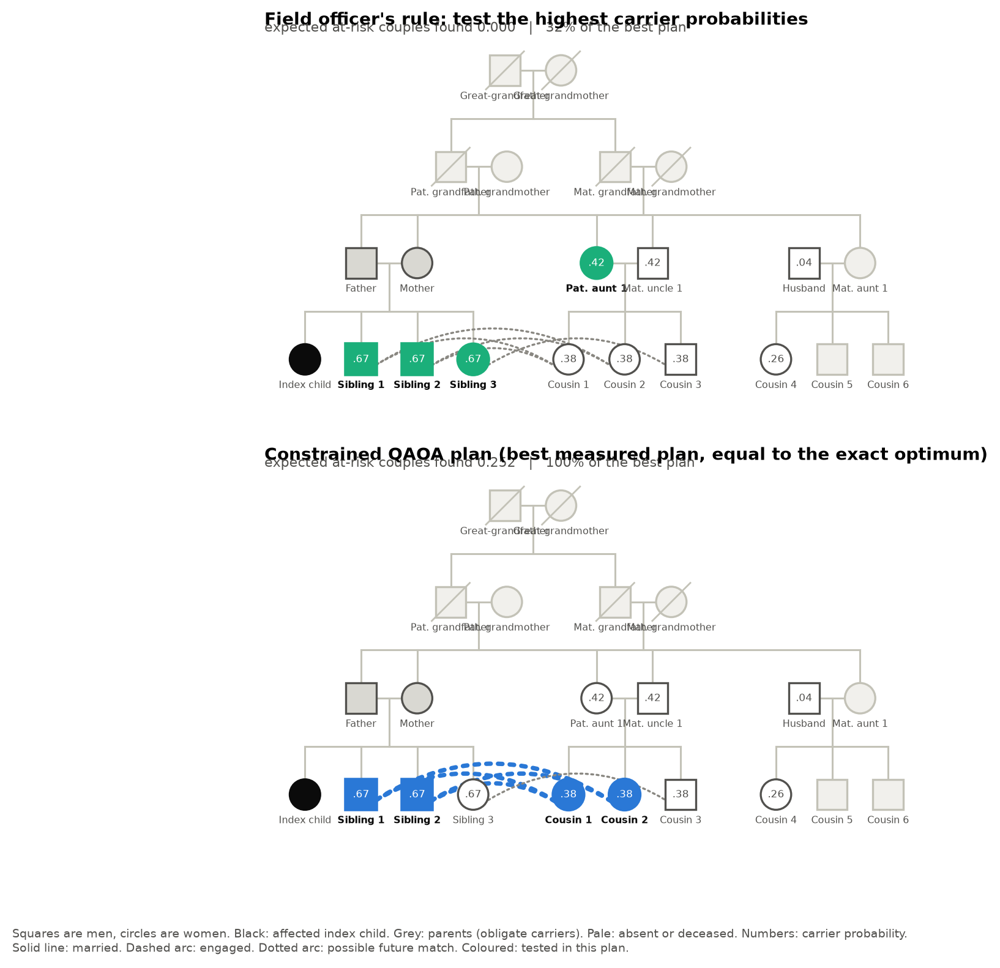
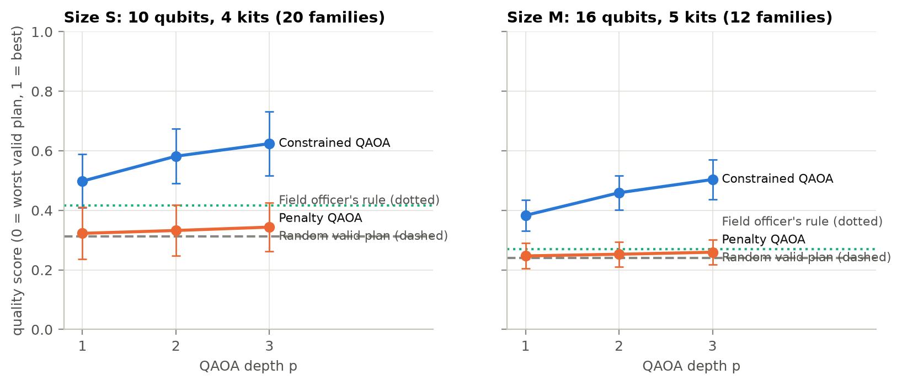
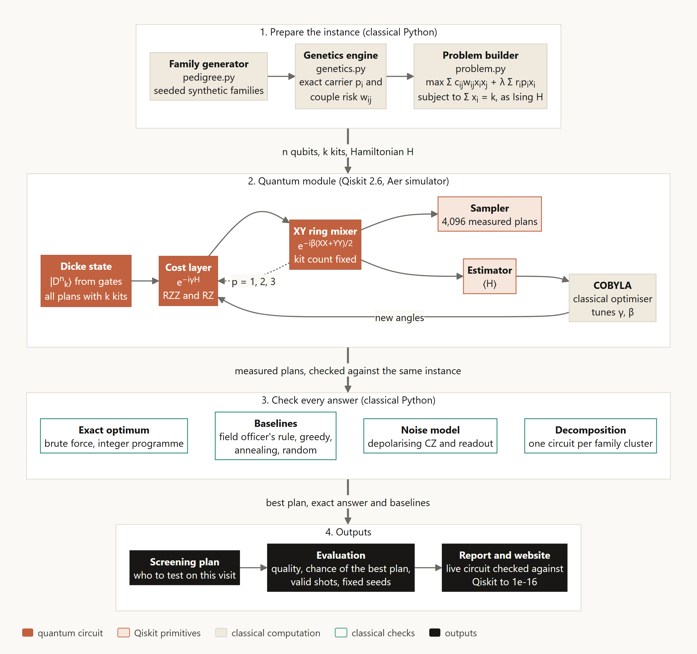

# Kinship Screening with QAOA

**Qiskit Fall Fest 2026 Hackathon. Domain: Healthcare.**

One home visit, k test kits: which relatives of a thalassaemia patient should be tested?

This project is a planning tool for beta-thalassaemia cascade screening in Pakistan. It chooses
exactly k relatives so that the expected number of at-risk couples identified is as large as
possible, using a QAOA circuit in Qiskit that cannot break the kit limit, and it checks every
answer against the exact optimum.

**Team:** Syed Muhammad Saad Bukhari, Abdul Ahad, Faizan

| Deliverable | Where |
|---|---|
| Working, reproducible Qiskit code | this repository, `kinship/` and `tests/` |
| Report (.docx) with results, exact comparison and limitations | [report/Kinship_QAOA_Report.docx](report/Kinship_QAOA_Report.docx) |
| Architecture diagram | [report/architecture.png](report/architecture.png), also Figure 1 of the report |
| Project website with the interactive walkthrough | `index.html`: open it in a browser after cloning (GitHub shows only its source) |
| Problem statement, benchmark report, limitations, references | [DOCS/](DOCS) |
| 3-minute video pitch and demo | link submitted with the entry form; script in [DOCS/VIDEO_SCRIPT.md](DOCS/VIDEO_SCRIPT.md) |

## The problem

Thalassaemia major appears only when both parents are carriers. About 5% of people in Pakistan
carry beta-thalassaemia, and in families that already have an affected child 31% of tested
relatives were carriers, against none in control families (Ahmed et al., NEJM 2002). Screening
teams therefore test the relatives of patients, but field capacity is limited: 48 field officers
cover the 36 districts of Punjab (Ahmed et al., EJHG 2022). We assume that the number of test kits
for a visit is the binding limit.

An at-risk couple can be confirmed only when **both** partners are tested, so the value of a visit sits on
pairs of people:

```
maximise    sum over couples (i,j) of  c_ij * w_ij * x_i * x_j   +   lambda * sum over i of  r_i * p_i * x_i
subject to  sum over i of x_i = k,     x_i in {0, 1}
```

`x_i` = 1 if relative i is tested, `w_ij` = probability that i and j are both carriers (computed
exactly from the family tree), `c_ij` = probability that the couple link is real, `p_i` = carrier
probability, `r_i` = relevance. Full statement: [DOCS/PROBLEM_STATEMENT.md](DOCS/PROBLEM_STATEMENT.md).

## Quick start

Python 3.11 or later is needed (the pinned packages do not support older versions). Everything was
tested with Python 3.11.0 on Windows.

Windows:

```bash
git clone https://github.com/AbdulAHAD968/Qiskit-IBM.git
cd Qiskit-IBM
python -m venv .venv
.venv\Scripts\activate
pip install -r requirements.txt
python -m kinship.demo
```

macOS or Linux:

```bash
git clone https://github.com/AbdulAHAD968/Qiskit-IBM.git
cd Qiskit-IBM
python3 -m venv .venv
source .venv/bin/activate
pip install -r requirements.txt
python -m kinship.demo
```

The demo takes about 20 seconds. It builds one synthetic family, computes carrier probabilities,
trains the constrained QAOA circuit, measures plans and compares them with the exact optimum.
Expected output (shortened):

```
Kinship screening demo: instance S-16
22 people in the family tree, 10 can be tested, 4 kits
...
Constrained QAOA in Qiskit: Dicke start state, RZZ cost layer, XY ring mixer
  depth 1: quality 0.516, chance one shot is the best plan 2.67%, valid shots 100%, ...
  depth 2: quality 0.586, chance one shot is the best plan 6.41%, valid shots 100%, ...
  depth 3: quality 0.631, chance one shot is the best plan 8.31%, valid shots 100%, ...
  random valid plan: quality 0.328, chance of the best plan 0.48%
...
plan                                     couples found    value  of best
Exact optimum                                    0.252    0.356     100%
Field officer's rule                             0.000    0.115      32%
Relevance-weighted rule                          0.126    0.245      69%
Greedy                                           0.252    0.356     100%
Constrained QAOA (best measured plan)            0.252    0.356     100%
------------------------------------------------------------------------------
Plan for this visit (constrained QAOA):
  test Cousin 1
  test Cousin 2
  test Sibling 1
  test Sibling 2
This matches the exact optimum.
Note: at this size brute force is instant. The demo shows the method, not a speedup.
```

It also saves the family tree with the chosen relatives highlighted to `results/figures/`.
Other families: `python -m kinship.demo --index 3`, `python -m kinship.demo --size M --index 1`,
or a new one with `python -m kinship.demo --seed 42 --n 9 --k 3`.



### With Docker

The image pins Python 3.11 and the versions in `requirements.txt`. By default it serves the project
website on port 8000; the same image runs the demo and the tests.

```bash
docker build -t kinship-qaoa .
docker run --rm -p 8000:8000 kinship-qaoa            # website at http://localhost:8000
docker run --rm kinship-qaoa python -m kinship.demo   # one-command demo
docker run --rm kinship-qaoa pytest                   # 57 checks
```

## Reproduce every number

```bash
pytest                               # 57 checks, a few seconds
python -m kinship.evaluate all       # all experiments, about 8 minutes on 8 processes
python -m kinship.evaluate all --quick   # reduced matrix, about 2 minutes (overwrites results/)
python -m kinship.validate_genetics  # independent Monte Carlo check of the genetics engine, about 1 minute
python -m kinship.compare_runs DIR   # compare results/ with the results folder DIR of another run
python -m kinship.plots              # results/figures/*.png and report/architecture.png
python -m kinship.report_md          # DOCS/BENCHMARKS.md
python -m kinship.export_web         # web/data/results.js for the website
python report/build_report.py        # report/Kinship_QAOA_Report.docx
```

Seeds are fixed and versions are pinned in `requirements.txt` (Qiskit 2.6.2, Qiskit Aer 0.18.2).
The committed `results/*.json` files are what `python -m kinship.evaluate all` produces. A second
full run in a fresh clone reproduced every value in them, timing fields aside; the check is recorded
in [DOCS/REPRODUCIBILITY.md](DOCS/REPRODUCIBILITY.md). The `--quick` run is only a smoke test:
it overwrites `results/` with a reduced matrix, so run the full matrix again before regenerating the
figures, the website data or the report.

To view the website, open `index.html` in a browser, or serve the folder:

```bash
python -m http.server 8000
```

## Results at a glance

Noise-free simulation, mean over 20 families with 10 relatives and 12 families with 16 relatives.
Quality is the expected value of a measured valid plan, scaled so the worst valid plan is 0 and the
best is 1; shots that break the kit limit are discarded first.

| Method | Quality, 10 qubits | Quality, 16 qubits | Best plan per shot, 16 qubits | Valid shots, 16 qubits |
|---|---:|---:|---:|---:|
| Random valid plan | 0.31 | 0.24 | 0.027% | 100% |
| Field officer's rule (highest carrier probability) | 0.42 | 0.27 | | 100% |
| Greedy | 0.86 | 0.78 | | 100% |
| Simulated annealing | 1.00 | 1.00 | | 100% |
| Penalty QAOA, depth 3 | 0.34 | 0.26 | 0.025% | 61% |
| **Constrained QAOA, depth 3** | **0.62** | **0.50** | **0.98%** | **100%** |

- The field officer's rule misses the best plan in 98% (10 relatives) and 100% (16 relatives) of
  50 seeded families, also when every tie in carrier probability is broken in its favour.
- Family by family, constrained QAOA makes one shot the best plan on average 12 times (10 qubits)
  and 32 times (16 qubits) more often than a random valid pick; the medians are 8 and 14 times. It
  never breaks the kit limit.
- Networks of 48 relatives and 12 kits are solved to the proven optimum with circuits of at most
  9 qubits, by splitting along the couple graph. The pieces are small enough for sampling to find
  each optimum easily, so this shows a scaling route, not an advantage.
- **No speedup is claimed.** Brute force and simulated annealing solve these sizes. See
  [DOCS/LIMITATIONS.md](DOCS/LIMITATIONS.md).

Full tables and figures: [DOCS/BENCHMARKS.md](DOCS/BENCHMARKS.md).



## How the quantum part works

| Problem piece | Quantum piece | Qiskit building block |
|---|---|---|
| Is relative i tested? | qubit i, state 1 means tested | `QuantumCircuit` |
| Couple weight | ZZ rotation on qubits i and j | `rzz`, `SparsePauliOp` |
| Single weight | Z rotation on qubit i | `rz` |
| Exactly k tests | Dicke start state and XY ring mixer | `cx`, `cry`, `ry`, `XXPlusYYGate` |
| Tuning the angles | classical optimiser loop | Aer `EstimatorV2` with SciPy COBYLA |
| Reading out plans | sampling the circuit | Aer `SamplerV2` |

Two variants are compared. **Constrained QAOA** starts in a Dicke state (built from gates, since
Qiskit has no built-in one) and uses an XY mixer, so every shot is a valid plan. **Penalty QAOA**
is the standard baseline with a penalty for using the wrong number of kits.



## Repository layout

```
kinship/
  pedigree.py        synthetic family generator (seeded, cousin and exchange marriages)
  genetics.py        exact carrier and couple probabilities on the family tree
  problem.py         objective, exactly-k rule, QUBO and Ising mapping, instances
  classical.py       brute force, integer programme, field rule, greedy, simulated annealing
  decompose.py       split along the couple graph, dynamic programme over kit budgets
  quantum/
    circuits.py      Dicke state, cost layer, XY ring mixer, both QAOA circuits
    qaoa.py          angle tuning (Estimator), read-out (Sampler), metrics
    noise.py         transpilation to RZ, SX, X, CZ and the Aer noise model
  evaluate.py        experiment runner, writes results/*.json
  plots.py           figures from the saved results
  report_md.py       DOCS/BENCHMARKS.md from the saved results
  export_web.py      website data from the saved results
  view.py            drawable view of a family
  validate_genetics.py  independent Monte Carlo check of the genetics engine
  compare_runs.py    compares the result files of two runs, ignoring timing fields
  demo.py            one-command demo
tests/               genetics values, objective and Ising mapping, circuits, decomposition
data/instances/      seeded S, M and L instances as JSON
results/             raw outputs (*.json) and figures
report/              the .docx report, its generator and the architecture diagram
DOCS/                problem statement, benchmark report, limitations, references, judge Q&A, video script
pytest.ini           lets `pytest` find the package from the repository root
Dockerfile           container image: serves the website, runs the demo and the tests
index.html, web/     project website (static, no dependencies)
```

## Limitations in short

Simulator only, no real quantum processor. Synthetic families calibrated loosely to one study.
One gene, a perfect test, one visit, and the kit budget assumed to be the binding limit. A classical
solver wins at these sizes, and family graphs are sparse enough for an exact dynamic programme.
Penalty QAOA barely beats random, a cheaper start state failed, and at 1% two-qubit error most shots
are lost. Details and numbers:
[DOCS/LIMITATIONS.md](DOCS/LIMITATIONS.md).

## Credits

- Constrained QAOA design (Dicke start state, XY mixer): Cook, Eidenbenz and Bärtschi, IEEE QCE 2020.
- Dicke-state circuit: Bärtschi and Eidenbenz, FCT 2019.
- Parity-ordered XY ring mixer: Wang, Rubin, Dominy and Rieffel, Phys Rev A 2020.
- INTERP warm start: Zhou, Wang, Choi, Pichler and Lukin, Phys Rev X 2020.
- Trade-off sweep idea: Kotil et al., Nat Comput Sci 2025.
- Pakistan figures: Ahmed et al., NEJM 2002; Ahmed et al., EJHG 2022; Pakistan DHS 2017-18.
- Libraries: Qiskit 2.6.2, Qiskit Aer 0.18.2, NumPy 2.4.6, SciPy 1.17.1, Matplotlib 3.11.2,
  python-docx 1.2.0, pytest 9.2.0.

All code in this repository was written for this project; the circuits were written from the
papers and no tutorial or third-party code was copied. An AI coding assistant was used to help
write code and draft text; every number is produced by running the code in this repository.
Full reference list: [DOCS/REFERENCES.md](DOCS/REFERENCES.md).

## Licence

MIT, see [LICENSE](LICENSE).
